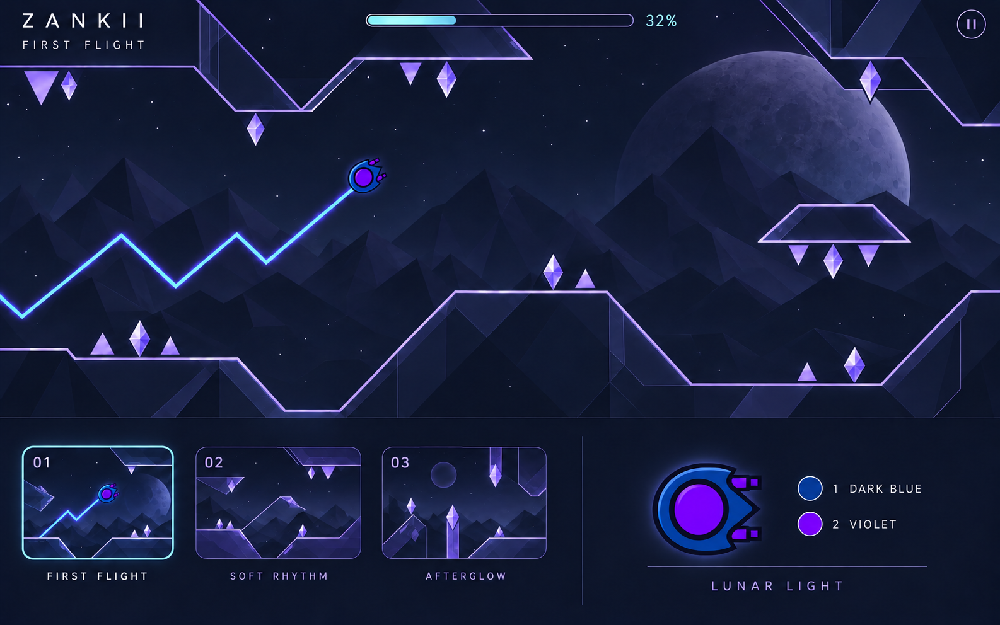

# Zankii

Игра с отдельными уровнями и управлением в духе режима Wave из Geometry Dash.

## Как играть

- Персонаж автоматически движется вперёд.
- Удерживаешь нажатие — движется по диагонали вверх.
- Отпускаешь — движется по диагонали вниз.
- Чередуешь нажатия и отпускания — проходишь препятствия зигзагом.

## Выбранное оформление

**«Лунный свет»**: спокойное ночное небо, луна, геометрические платформы и фиолетовые кристаллы.

Персонаж — **Fat Wave**: первый цвет тёмно-синий, второй фиолетовый. Препятствия очищены от лишних и пересекающихся шипов.

## Состояние проекта

Согласованы основа игры и направление оформления. Подготовлены эскизы; игровой код пока не создан.

Предложенные названия первых уровней: «Первый полёт», «Тихий ритм», «Послесвечение».

## Файлы проекта

- [Правила проекта](AGENTS.md).
- [Эскизы оформления](design/style-options/).
- [Описание создания первоначальных эскизов](design/style-options/prompts.json).
- [Описание обновлённого эскиза](design/style-options/lunar-v3-prompt.json).

Эскизы созданы с помощью imagegen. Образец формы Fat Wave (Wave 17) взят из [каталога GDBrowser](https://gdbrowser.com/iconkit/); исходные игровые значки принадлежат RobTop Games.
